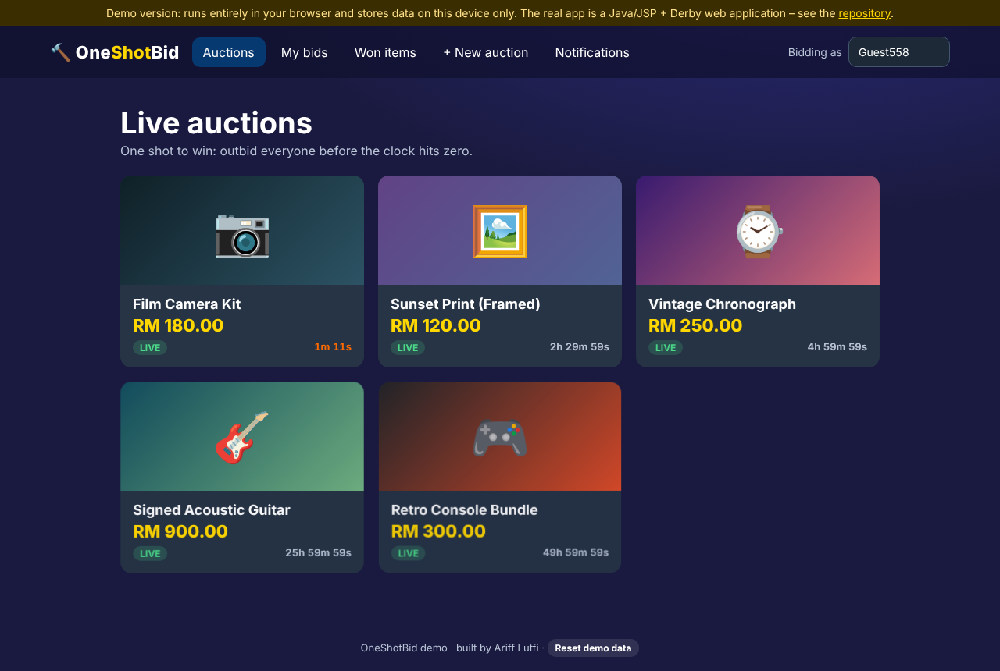

# 🔨 OneShotBid

An online auction platform: sellers list items with a start price and a time window, buyers place bids, the highest bidder wins when the clock runs out, gets a notification and pays.

| | |
|---|---|
| 🌐 **Try it in your browser (demo)** | https://yutfi.github.io/OneShotBid2/ |
| 💻 **Full application** | Java (Jakarta EE 10) + JSP on GlassFish 7 with Apache Derby – see [Run the full app](#run-the-full-app) |
| 📱 **Android APK** | None – this is a server-side web app, so there is no APK. Open the site on a phone browser instead. |

> The demo link works once GitHub Pages is switched on (Settings → Pages → Source: **GitHub Actions**).



## Two versions – what's the difference?

| | Browser demo (`docs/`) | Full app (`src/`, `web/`) |
|---|---|---|
| Runs on | any browser, GitHub Pages | GlassFish + Derby (your machine or server) |
| Data | stored in *your* browser only | shared Derby database |
| Users | switch the “Bidding as” name | real sign-up / login |
| Purpose | try the flow instantly | the real project |

The demo follows the same rules as the real app: a bid must beat the start price and the current highest bid, auctions end at their end time, the winner is notified and can pay (no real payment happens in the demo).

## Features (full app)

- Sign-up, login, logout; admin flag for managing auctions
- Create / edit / delete auctions with image upload
- Place bids with validation, live bid history
- Auctions end automatically; winner notification and payment page
- Notifications page
- Animated, responsive pages (shared `web/css/modern.css` – fade-ins, staggered cards, hover effects; respects *reduce motion*)

## Project structure

```
src/java/servlets/   Login, Signup, PlaceBid, AddAuction, EditAuction, MakePayment, ImageServlet, …
src/java/bean/       Auction, Product, User
src/java/util/       DBConnector (reads settings from environment variables)
web/                 JSP pages + css/modern.css
database/schema.sql  Derby tables (reconstructed from the code's SQL)
docs/                Static browser demo (GitHub Pages)
.github/workflows/   build.yml (compile + WAR), pages.yml (deploy demo)
```

## Run the full app

Requirements: JDK 17+, GlassFish 7 (Jakarta EE 10) and Apache Derby (bundled with GlassFish), or NetBeans with GlassFish.

1. **Start Derby** (network server on port 1527) and create the database:
   ```
   ij> connect 'jdbc:derby://localhost:1527/auction_db;create=true;user=app;password=app';
   ij> run 'database/schema.sql';
   ```
2. **Image folder** – uploaded images are saved to `~/auction-images` (or `C:\auction-images` on Windows). Change with `ONESHOTBID_IMAGE_DIR`.
3. **Build** – open the project in NetBeans (Ant) and *Run*, or take the `OneShotBid.war` from the latest *Compile and package WAR* workflow run and deploy it: `asadmin deploy OneShotBid.war`.
4. Open `http://localhost:8080/OneShotBid/` and sign up.

Optional settings (environment variables): `ONESHOTBID_DB_URL`, `ONESHOTBID_DB_USER`, `ONESHOTBID_DB_PASS`, `ONESHOTBID_IMAGE_DIR`.

## What changed in this update

- Removed committed build output (`build/`, `dist/*.war`, `nbproject/private`) and added `.gitignore`
- Added `database/schema.sql` so the database can be recreated (it was missing)
- Database login and image folder are configurable instead of hard-coded
- Fixed a path-traversal weakness in the `/image/*` servlet, and image uploads no longer fail when two files share a name
- Added the animation layer and the browser demo
- Added CI that compiles the servlets and builds the WAR

## Testing and limitations

- The browser demo was tested in headless Chrome (bidding rules, auction end → win → pay, creating auctions, persistence, mobile layout, no console errors).
- CI compiles the Java sources and packages the WAR. The full application has **not** been started against a live GlassFish/Derby instance in this update, and `schema.sql` is reconstructed from the code, so compare it with your real database first.
- **Known issue:** passwords are stored and compared as plain text. Before any real use, hash them (e.g. PBKDF2/bcrypt) in `SignupServlet` / `LoginServlet`.
- The DB account `app/app` is a development default – change it for anything public.

## Author

Ariff Lutfi Bin Shahrim (UiTM).
